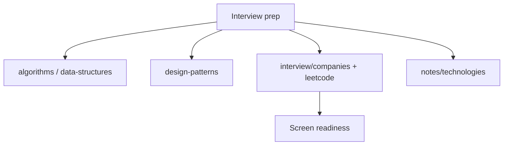

# Frontend Interview Prep

### **JavaScript / TypeScript interview handbook — algorithms to company screens.**

[](https://developer.mozilla.org/en-US/docs/Web/JavaScript)
[](https://www.typescriptlang.org/)
[](#-contents)
[](#-quick-start)
[](https://github.com/anatoly-kulishov/frontend-interview-prep/pulls)

[Contents](#-contents) · [Companies](#-companies-covered) · [Quick start](#-quick-start) · [Naming](#-naming-conventions)

---

Personal handbook for **frontend coding interviews**: algorithms, data structures, GoF design patterns, LeetCode-style tasks, React / TypeScript drills, and solutions from real company screens (Yandex, Avito, Revolut, Tinkoff, Wildberries, and more).

**No build step** — open any `.js` / `.ts` file and run it with Node or in the browser console.

**Keywords:** frontend interview, JavaScript interview, TypeScript interview, coding interview, LeetCode, algorithms, data structures, design patterns, React interview, Yandex frontend, Avito interview, Revolut frontend task.

---

## Why this repo?

| Without a handbook | With this prep kit |
| :--- | :--- |
| Tasks scattered across bookmarks | One tree: algorithms → patterns → companies |
| “I’ll solve it later” without structure | Named problems + session dumps by year |
| Framework-only practice | Vanilla JS patterns + React/TS drills |
| Opaque company screens | Folders per company with real-style tasks |



---

## Contents

| Path | What is inside |
| :--- | :--- |
| [`algorithms/`](algorithms/) | Search, sorts, misc algorithms |
| [`data-structures/`](data-structures/) | Array, linked list, stack, queue, hash table, tree, graph |
| [`design-patterns/`](design-patterns/) | Creational, structural, behavioral (GoF) in vanilla JS |
| [`helpers/`](helpers/) | Timing, test helpers, hashing |
| [`interview/`](interview/) | Company tasks, LeetCode, React, TypeScript, sessions |
| [`notes/technologies/`](notes/technologies/) | Short notes (Node, Next.js, Redux, Webpack, …) |

### Interview layout

```text
interview/
├── companies/     # aston, avito, yandex, revolut, tinkoff, …
├── leetcode/      # easy | medium by topic
├── react/
├── typescript/
├── html/
└── sessions/      # year-based practice dumps
```

---

## Companies covered

[alfa-bank](interview/companies/alfa-bank/) ·
[aston](interview/companies/aston/) ·
[avito](interview/companies/avito/) ·
[epam](interview/companies/epam/) ·
[hh](interview/companies/hh/) ·
[mts](interview/companies/mts/) ·
[okko](interview/companies/okko/) ·
[revolut](interview/companies/revolut/) ·
[sber-risks](interview/companies/sber-risks/) ·
[tele2](interview/companies/tele2/) ·
[tinkoff](interview/companies/tinkoff/) ·
[vk](interview/companies/vk/) ·
[wildberries](interview/companies/wildberries/) ·
[x5](interview/companies/x5/) ·
[yandex](interview/companies/yandex/)

---

## Naming conventions

- Paths and filenames: **kebab-case**, ASCII only
- Prefer the **problem name** in the filename (`memoize.js`, `solo-keyboard-game.js`)
- Company folders: lowercase English / transliteration (`tinkoff`, not `Тинькофф`)

---

## Quick start

```bash
git clone https://github.com/anatoly-kulishov/frontend-interview-prep.git
cd frontend-interview-prep

# example
node interview/companies/yandex/2026/coderun/memoize.js
```

Tip: pick one company folder or one LeetCode topic per session and time-box it.

---

## Suggested path

1. Warm up: `algorithms/` + `data-structures/`
2. Patterns: `design-patterns/` (creational → structural → behavioral)
3. LeetCode track: `interview/leetcode/`
4. Target company: `interview/companies/<name>/`
5. Framework drills: `interview/react/`, `interview/typescript/`

---

## FAQ

**Is this an official company dump?**  
No. Personal learning material inspired by public screens and practice. Not affiliated with any employer.

**TypeScript or JavaScript?**  
Both. Many tasks are plain JS; TS drills live under `interview/typescript/`.

**Can I use this commercially / in a course?**  
Use at your own risk. Prefer attribution if you republish structure or notes.

---

## License

Personal learning material. Use at your own risk; not an official dump of any company’s private tasks.

---

**If this handbook helps your next screen — ⭐ the [repo](https://github.com/anatoly-kulishov/frontend-interview-prep).**
